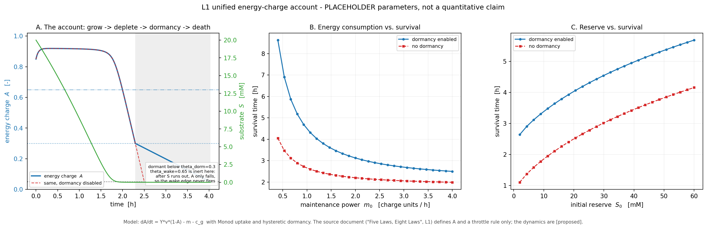
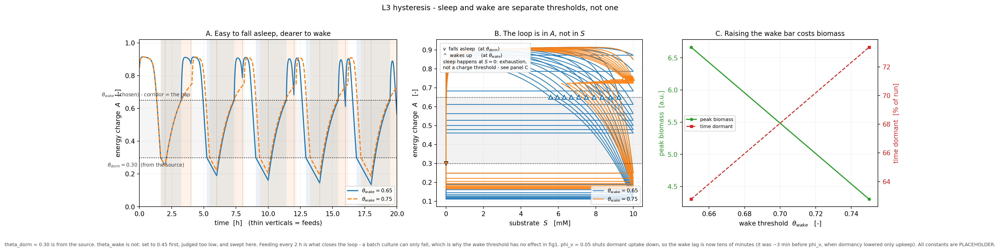
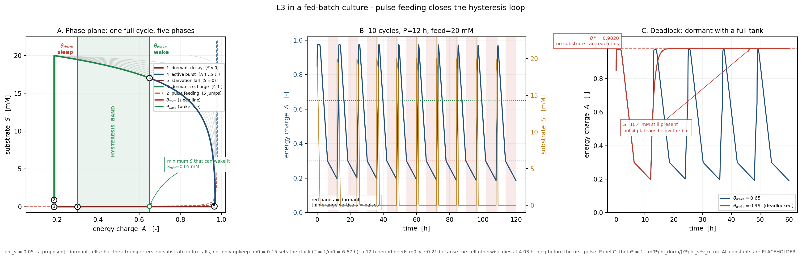

# 2. Method

## 2.0 Naming conventions and the status of every symbol

Two naming conventions are fixed here and used without exception in Sections 2–5.

**M1 / M2.** The dormant and active phases are governed by *different* equations,
and the paper refers to them as separate models:

| label | phase | equation | character |
|:--|:--|:--|:--|
| **M1** | dormant | $\dot A = Y\phi_v v(S)(1-A)-\phi_{\mathrm{dorm}}m_0$ | saturating, negative feedback $(1-A)$ |
| **M2** | active | $\dot A = \dfrac{m_0}{D_0}\big[(1+\epsilon_m)d-c\big]$ | linear accounting, no feedback |

The earlier draft used "M1" for the active branch and "M2" for the dormant one.
That labelling is reversed here, and it is reversed because the substantive claim
is that the two are *not* the same model: the labels follow the order in which
the results depend on them, not the order in which they appear in a cycle. Any
citation of the earlier draft must be read with this swap.

**Ax / A.** Axioms are written `Ax1`–`Ax9`. Implicit assumptions inventoried by
the audit are written `A1`–`A28`. The two numbering schemes are unrelated:
`A5` (an assumption about the active law) is realised by `Ax3` (the axiom), not
by `Ax5` (the commitment policy). Table 1 is the only place where both numbering
schemes appear in the same row; the verification report (§3.1) gives the full
inventory, including the seventeen entries that are not load-bearing.

**Quantities.** $C$ is the cycle-mean capacity (what an agent can deliver over a
cycle); $W$ is the pulse peak (the rate at which a dormant agent charges).
They differ by a factor of $1.74$ in the reference scenario and are never
interchanged. $\chi$ is the charging margin; $\chi_0$ is $\chi$ evaluated at
$W=V_{\max}$, and $f=W/V_{\max}$. The two are routinely confused in the numbers,
so we fix the reference values once: $c_0=Y\phi_v/(m_0\phi_{\mathrm{dorm}})=5.5556$,
$\chi_0=c_0V_{\max}=55.556$, and at the operating point $W(1)=v(S_0)=3.2$ one has
$f=0.32$ and $\chi(1)=f\chi_0=17.7778$. A quoted margin is meaningless without
saying which of the two it is.

**Two symbols that are not the same symbol.** Delta appears twice with unrelated
meanings, written differently so that a reader who meets one cannot silently
substitute the other. $\delta$ is the *upkeep deficit*: maintenance owed but not
paid between the saturation reference and the onset, in units of $m_{0,i}$
(Corollary 4, §2.6). $\Delta_{\mathrm{drift}}$ is the *linear drift rate*: the
per-step decline of the mean under the C3 null (Proposition 5, §2.8). The first
is a stock, bounded by the horizon; the second is a rate. The earlier draft wrote
both as $\delta$, separating them only by context; the subscript is the fix.

**Three epsilons, two glyphs.** The letter carries three unrelated roles, and the
glyph together with the subscript is what separates them. $\epsilon_m$ (lunate
$\epsilon$, subscript $m$) is the *accounting markup* of Ax3: a delivered unit is
credited at $1+\epsilon_m$ times its own capacity against a maintenance charge of
one, and $\epsilon_m=0.15$ in §2.9. It is what sets the duty-cycle threshold
$\epsilon_m/(1+\epsilon_m)=13.04\%$ of §3.7. $\varepsilon$ (bare) is the *drift rate* of Ax7: the fractional decrement of $R$
per ten-cycle block, $\varepsilon=0.01$, applied multiplicatively so that
$R=(1-\varepsilon)^{k}$ after $k$ blocks. Its logarithmic equivalent is
$-\ln(0.99)=0.01005$, not $0.01$; the paper uses the multiplicative form
throughout, and every number in §3.5 is computed from it.
$\varepsilon_n$ and $\varepsilon_0$ (subscripted without $m$) are the
*observation noise* of the C3 null in Proposition 5, i.i.d. with zero mean and
variance $\sigma^2$. Markup and drift differ by a factor of fifteen and never
appear in the same expression --- Ax3 and its corollaries against Ax7 and A.1 ---
so substituting one for the other produces a visible inconsistency rather than a
rounding error. That is the whole reason they are printed with different glyphs;
it is not a claim that they are related.

**$\kappa$, $\kappa_i$, and $A_{\mathrm{sleep}}$.** Three run lengths govern the
switch, and none of them is a charge. $\kappa_i$ is a *state*: the agent's
current run of consecutive cycles that satisfy the gate it is under (§2.1).
$\kappa$ without a subscript is the *constant* a rule requires, $\kappa=3$ in
§2.9, and the same length governs both waking (Ax6, H3) and the deadlock
confirmation of I5, because one shocked or borderline sample is evidence in
neither direction; the counters are separate and start at zero.
$A_{\mathrm{sleep}}$ is not a charge despite the letter: it is the number of
consecutive `FAIL` verdicts that triggers dormancy (Ax6, A.2), equal to $2$ in
§2.9. The earlier draft wrote that clause $f\ge2$ with $f=W/V_{\max}$; since
$W\le V_{\max}$ the predicate could never fire, and it was never what the
implementation tested.

## 2.1 State space and domains

Time is discrete, $t\in\mathbb{N}$, one step per fed-batch cycle. The state of
agent $i$ is

$$
x_i(t)=\big(A_i,\,m_i,\,c_i,\,d_i,\,\kappa_i\big),
$$

with domains

$$
A_i\in\mathbb{R},\qquad
m_i\in\{\mathrm{act},\mathrm{dorm},\mathrm{dead}\},\qquad
c_i\in[0,C_{0,i}],\qquad
d_i\in[0,c_i],\qquad
\kappa_i\in\mathbb{N}_0 .
$$

Two domain conventions are adopted deliberately and they constrain what can be
claimed later.

1. **$A$ is not restricted to $[0,1]$.** `Ax3` is linear and does not preserve the
   unit interval. The implementation projects the upper bound
   ($A\leftarrow\min(A,1)$) and treats $A\le0$ as an absorbing event. A projection
   is not an invariant, so the model is an affine system with an absorbing set,
   not a flow on a compact simplex. Lemma 1 is stated for the branch $A<1$, which
   is the only branch Theorem 1 uses.
2. **$A\le0$ is death, not equilibrium.** `Ax8` makes it irreversible. There is
   therefore no interior equilibrium of `M2` with $d=0$; the only fixed point of
   the active law with zero delivery lies on the boundary.

The environment state is $(R,\sigma)$, with $R>0$ the resource index and
$\sigma\in\{\sigma_s,1\}$ the shock multiplier. Capacity and peak are

$$
C(t)=\frac{1}{n}\sum_{j=0}^{n-1}v\big(S_0R(t)(1-\delta_s)^j\big)\sigma(t),
\qquad
W(t)=v\big(S_0R(t)\big)\sigma(t),
$$

with $n=8$, $\delta_s=0.22$, $S_0=0.5$. In the reference scenario
$C(1)=1.8426$ and $W(1)=3.2000$.

Figure 1 fixes the vocabulary of the rest of the paper: the charge account of a
single agent with dormancy enabled and disabled, and the two surfaces against
which the reserve is read.

{width=100%}

## 2.2 Axioms

The following nine statements are the entire starting set. Anything not derivable
from them is labelled empirical.

**Ax1 (uptake).** $v(S)=V_{\max}S/(K_s+S+S^2/K_i)$, with
$V_{\max}=10$, $K_s=1$, $K_i=4$. $v\in C^\infty$, $v(0)=0$, $v$ is increasing on
$[0,\sqrt{K_sK_i})=(0,2)$ and decreasing beyond. The operating point is
$S_0=0.5<2$, so $C$ increases in $R$ throughout the scenario. Figure 2 shows
the law and its inhibitory branch.

{width=100%}

**Ax2 (dormant charging, M1).** For $m=\mathrm{dorm}$,
$\dot A=Y\phi_v v(S)(1-A)-\phi_{\mathrm{dorm}}m_0$. This is the law on the
shock-free branch. During an episode the uptake is $W=\sigma_sv(S)$, and the same
equation holds with $v(S)$ replaced by $W$; because D8 defines $\chi$ on the peak
$W$, the identity $A_\infty=1-1/\chi$ is the fixed point of this equation exactly
when $W=v(S)$, which is the branch on which Theorem 1's deadlock verdicts are
issued (I5).

**Ax3 (active accounting, M2).** For $m=\mathrm{act}$,
$\dot A=\dfrac{m_0}{D_0}[(1+\epsilon_m)d-c]$.

**Ax4 (delivery map).** $d=c\cdot\mathbf{1}[C\ge c]$ for Type-A (atomic);
$d=\min(c,C)$ for Type-B (divisible).

**Ax5 (commitment policy).** $c_A\equiv D_0$; $c_B=a$ with
$a_{t+1}=\min(D_0,1.05a_t)$ on `PASS` and $a_{t+1}=0.95a_t$ on `FAIL`.

**Ax6 (hysteresis switch; Type-B).** For an agent that may enter dormancy
(Type-B; I4 excludes Type-A), $\mathrm{act}\to\mathrm{dorm}$ iff
$A<\theta_{\mathrm{dorm}}$ or $A_{\mathrm{sleep}}$ consecutive cycles were judged
`FAIL`; $\mathrm{dorm}\to\mathrm{act}$ iff $A\ge\theta_{\mathrm{wake}}$ for
$\kappa$ consecutive cycles. The second entry condition is the verdict streak of
§2.7, not a load ratio; the implementation keeps it as `SLEEP_AFTER=2`.

**Ax7 (environment).** $R$ is multiplied by $1-\varepsilon$ every $10$ cycles,
so that $R(t)=(1-\varepsilon)^{\lfloor t/P\rfloor}$;
$\sigma=\sigma_s$ on cycles $t\bmod P\in\{0,\dots,L-1\}$ and $1$ otherwise.

**Ax8 (death).** $A\le0\Rightarrow m=\mathrm{dead}$, irreversibly.

**Ax9 (independence).** Agents share the exogenous $C(t)$ and do not interact.
$v_i$ and $m_{0,i}$ are independent static lognormal factors with
$\sigma_v=0.08$, $\sigma_m=0.12$.

**Inference rules.** Ten rules are used, and a statement derived with anything
else is not a proof in this paper: modus ponens (IR1); universal instantiation,
agent to population (IR2); induction, used for the cascaded product (IR3);
monotone convergence, used for $A(t)\to A_\infty$ (IR4); comparison principle and
Gronwall, used for the quasi-static error (IR5); l'Hôpital and asymptotic
expansion, used for the tail of $v$ (IR6); reductio, used for the no-loop theorem
and for the empty-set argument of §2.7 (IR7); Lyapunov functions, used for the
closed batch system (IR8); the law of large numbers, used for the $N\to\infty$
reading of the boundary (IR9); and the delta method, used for the interval on
$\tau$ (IR10). A numerical agreement is not a proof, a parameter sweep is not a
proof, and a parameter chosen to produce a phenomenon is not a derivation: any
statement that rests on those three is recorded as an empirical regularity.

**Table 1. The eleven load-bearing assumptions of the audit, and what each supports.**

| ID | assumption in words | axiom / decision that realises it | result that fails if it is false |
|:-------|:------------------------|:----------------------|:---------------------------|
| A1 | uptake is algebraic, not stateful | Ax1 | $\chi$ undefined; Theorem 1 not computable |
| A5 | the active phase is linear with no feedback | Ax3 (M2) | recovery to $A\approx0.95$; no extinction |
| A7 | M1 and M2 may be joined at the switch | Ax6 | two theorems about two systems; the join is unjustified |
| A8 | failed work earns nothing | Ax3 with $d=0$ | extinction disappears |
| A10 | Type-A tasks are atomic | Ax4 | positive margin at cycle 100; no step |
| A13 | no reproduction, inheritance or variation | Ax9 | cohort survival, not evolution |
| A14 | agents are independent | Ax9 | frequency dependence; a genuine phase transition possible |
| A16 | utilisation is fixed | scenario choice | ordering reverses near $U=0.445$ |
| A20 | the wake gate is peak-to-peak | wake rule, §2.7 | $279\to233$ or $983$ |
| A21 | deadlock needs three shock-free samples | §2.7, I5 | spurious left tail at $\theta=0.90$ |
| A27 | all eleven kinetic constants are placeholders | parameter table | numbers are dimensionless shapes, not predictions |

## 2.3 Definitions

Twelve definitions are used. They are numbered to agree with the formal
verification report, so that a reader can move between the two documents without
re-indexing.

**D1 (delivery and commitment).** $d_i(t)$ is the work that actually landed in
cycle $t$; $c_i(t)$ is the scope the agent committed to before the cycle began.

**D2 (availability).** $\mathrm{Avail}_i(t)=d_i(t)/c_i(t)$ for $c_i(t)>0$, with
the convention $0/0=0$. This makes
$\mathrm{Obs}_i=\mathrm{Cap}_i\cdot\mathrm{Avail}_i$ an identity rather than a
theorem, which is why availability cannot be used as independent evidence about
capacity.

**D3 (observation).** $\mathrm{Obs}_i(t)=\mathrm{Cap}_i(t)\cdot\mathrm{Avail}_i(t)$.
Type-A records $\mathrm{Cap}_i=c_i$, so its observation is the claim; Type-B
records $\mathrm{Cap}_i=d_i$, so its observation is the delivery.

**D4 (deadlock).** $\mathrm{DL}_i:\iff m_i=\mathrm{dorm}\ \land\
\lim_{t\to\infty}A_i(t)<\theta_{\mathrm{wake}}\ \land\ \exists S>0:v(S)>0$.
The third clause separates deadlock (resources present, charge unreachable) from
starvation (resources absent).

**D5 (stranding).** $\mathrm{ST}_i:\iff m_i=\mathrm{dorm}\ \land\
\forall t\ge t_0:W_i(t)<w_h$, $w_h=0.85\,W_i(1)$. $\mathrm{DL}$ is a statement
about the limit of $A$; $\mathrm{ST}$ is a statement about the supply side. Neither
implies the other.

**D6 (extinction).** $E_A(t):\iff\#\{i:\ \mathrm{kind}_i=A,\ m_i\ne
\mathrm{dead}\}=0$.

**D7 (collapse).** Operational definition used by the code: with $b$ the median
of $d_A$ over the first 20 cycles,
$t_{\mathrm{collapse}}=\max\{t:d_A(t)\ge b/2\}+1$. This is a definition, not a
theorem; a different threshold gives a different cycle.

**D8 (charging margin).** $\chi_i(t)=Y\phi_vW_i(t)/(m_0\phi_{\mathrm{dorm}})$ and
$\theta^\ast_i(t)=1-1/\chi_i(t)$. With the $V_{\max}$ normalisation
$\chi_{0,i}=Y\phi_vV_{\max}/(m_0\phi_{\mathrm{dorm}})$ and $f_i=W_i/V_{\max}$,
one has $\chi_i=f_i\chi_{0,i}$.

**D9 (cumulative causal potential).**
$\Phi_n=S_0-\hat S_n=\sum_{k\le n}(\hat S_{k-1}-\hat S_k)$.

**D10 (hysteresis loop).** A state sequence that returns repeatedly to
$[\theta_{\mathrm{dorm}},\theta_{\mathrm{wake}}]$ with the upward and downward
edges triggered by conditions of different type (one autonomous, one exogenous).
We flag here that this definition writes *asymmetry* into the definiens, so that
"asymmetry is necessary for a loop" is a tautology under D10 and false under the
standard dynamical-systems reading; §2.8 uses the standard reading, which is why
the general claim is withdrawn.

**D11 (phase transition).** An order parameter $s(g)$ is non-analytic at some
$g_c$, or the susceptibility $\chi=-\partial s/\partial g$ diverges there, and the
behaviour survives $N\to\infty$. This is the strict definition used to reject the
phase-transition reading in §3.5.

**D12 (functional).** Alive and not stranded: $m\ne\mathrm{dead}\ \land\
\lnot\mathrm{ST}$. This is the ordinate of panel 1 of the sandbox figure in §3.1.

## 2.4 The two-regime model

Figure 3 shows the phenomenon the switch `Ax6` is there to represent: in a
periodic feeding regime the charge returns to the band every cycle while the
substrate does not, so the loop lives in $A$ and not in $S$. Figure 4 shows the
same structure in a closed fed batch, where the cycle is a genuine limit cycle
and the deadlock at $\theta_{\mathrm{wake}}=0.99$ is visible as an agent pinned
below the threshold with substrate still in the vessel.

{width=100%}

{width=100%}

**Proposition 1 (M1 and M2 are not equivalent).** Fix $v>0$ and write
$a=Y\phi_vv>0$, $b=\phi_{\mathrm{dorm}}m_0>0$. `M1` has the interior fixed point
$A^\ast_{\mathrm{M1}}=1-b/a=1-\phi_{\mathrm{dorm}}m_0/(Y\phi_vv)$, which is
exponentially stable with rate $a=Y\phi_vv$. `M2` with $d=0$ has no interior
fixed point and decreases at the constant rate $m_0c/D_0$; with $d=c$ it
increases without bound until the projection acts. The two have opposite
qualitative behaviour for every $v>0$.

The fixed point is the same expression as $A_\infty=1-1/\chi$ of Lemma 1, because
D8 defines $\chi=Y\phi_vv/(\phi_{\mathrm{dorm}}m_0)=a/b$; a reader who meets
$1-1/\chi$ in §2.5 and $1-b/a$ here is reading one formula, not two.

*Proof.* $\partial\dot A/\partial A=-Y\phi_vv=-a<0$ for `M1`, so the deviation
from the fixed point decays as $e^{-at}$; $\partial\dot A/\partial A=0$ for `M2`,
which is therefore affine in $A$ and has no interior fixed point when $d=0$.
$\square$

**Corollary 1 (the 107-cycle extinction belongs to M2).** On the reference
capacity trajectory `M1` predicts
$A^\ast=1-\phi_{\mathrm{dorm}}m_0/(Y\phi_vv)=1-0.018/0.32=0.94375$ at the day-1
peak $W(1)=v(S_0)=3.2$, and $0.9402$ at $W(100)=3.008$, both above $A(0)=0.85$;
hence $A$ would rise toward the fixed point with $\tau=3.125$ cycles and would
not fall. The largest shock in the record subtracts at most $Lm_0=0.30$, about a
third of the fixed point, and even at the largest sampled $m_{0,i}=0.183$ the
subtraction is $2m_{0,i}=0.37$: $A$ stays above $\theta_{\mathrm{dorm}}=0.30$, so
no shock drives it into dormancy, and the loss is restored within
$3\tau\approx9$ cycles. The onset at cycle 100 lies seven cycles after the
episode 92–93 and fifteen before the next, so no shock is inside the decisive
window. `M2` with $d=0$ decreases at $m_0$ per cycle and crosses zero in
$A(100)/m_0\approx4.6$ cycles. The extinction is a property of the accounting
law, not of the metabolic law.

This proposition is the reason the paper does not present a unified equation.
`Ax6` joins the two regimes; the join is assumption A7, and it is an assumption
because no limit of one law produces the other at the switching manifold: M1 has
a stable interior point where M2 has none, and M2 has a conserved linear drift
where M1 has exponential relaxation.

## 2.5 Theorem 1: the deadlock boundary

Figure 1 gives the charge account that Lemma 1 formalises: growth, substrate
depletion, dormancy and death for the same strain with dormancy enabled and
disabled, together with survival against maintenance rate and against initial
reserve. Figure 5 is the phase diagram of the resulting boundary in the
$(\theta_{\mathrm{wake}},\chi)$ plane, with the analytic line of Theorem 1 drawn
on it.

{width=100%}

**Lemma 1 (closed form).** If $S$ is fixed on the charging time scale, `M1` has

$$
A(t)=A_\infty+\big(A(0)-A_\infty\big)e^{-t/\tau},\qquad
A_\infty=1-\frac{1}{\chi},\qquad
\tau=\frac{1}{m_0\phi_{\mathrm{dorm}}\chi}.
$$

*Proof.* Write `Ax2` as $\dot A=-(A-A_\infty)/\tau$ and integrate. $\square$

**Lemma 2 (monotonicity).** $A(t)$ is monotone between $A(0)$ and $A_\infty$ and
does not oscillate. *Proof.* The error term is an exponential with a fixed sign. $\square$

**Lemma 3 (no crossing).** If $A(0)\le\theta$ and $A_\infty<\theta$, then
$A(t)<\theta$ for all $t>0$. *Proof.* By Lemma 2, $A(t)$ lies between $A(0)$ and
$A_\infty$; if $A(0)=\theta$ the approach is strict. $\square$

**Lemma 4 (threshold equivalence).** For $\theta\in(0,1)$ and $\chi=f\chi_0$,

$$
A_\infty<\theta\iff\chi<\frac{1}{1-\theta}\iff\chi_0<\frac{1}{f(1-\theta)}.
$$

*Proof.* $1-1/\chi<\theta\iff\chi<1/(1-\theta)$; substitute $\chi=f\chi_0$. $\square$

**Theorem 1.** Assume

- **H1 (entry):** at the first dormant cycle, $A(0)\le\theta_{\mathrm{wake}}$;
- **H2 (quasi-static):** $S$ is constant to within the tolerance of Lemma 1 on
  the scale $\tau$;
- **H3 (wake rule):** waking requires $A\ge\theta_{\mathrm{wake}}$ for $\kappa$
  consecutive cycles.

Then

$$
\mathrm{DL}\iff A_\infty<\theta_{\mathrm{wake}}
\iff \chi<\frac{1}{1-\theta_{\mathrm{wake}}}=:\chi_{\min}
\iff \chi_0<\frac{1}{f\,(1-\theta_{\mathrm{wake}})}=\frac{\chi_{\min}}{f}.
$$

*Proof.* ($\Leftarrow$) By H1 and Lemma 3, $A(t)<\theta_{\mathrm{wake}}$ for all
$t\ge0$, so H3 never fires; by D4, deadlock. ($\Rightarrow$) Suppose
$A_\infty>\theta_{\mathrm{wake}}$. By Lemma 2, $A$ approaches $A_\infty$ from
below. If $A(0)\le\theta_{\mathrm{wake}}$, there is a finite

$$
t_c=\tau\ln\frac{A_\infty-A(0)}{A_\infty-\theta_{\mathrm{wake}}}
$$

with $A(t_c)=\theta_{\mathrm{wake}}$; after $\kappa$ further cycles H3 is
satisfied. If $A(0)>\theta_{\mathrm{wake}}$ the threshold is met immediately.
Hence no deadlock. Lemma 4 gives the equivalence chain. $\square$

**The critical case is a definition gap, not a theorem.** At
$\chi=\chi_{\min}$ we have $A_\infty=\theta_{\mathrm{wake}}$; $A$ approaches
the threshold strictly from below and never attains it, so H3 never fires while
D4 (strict inequality) does not classify the agent as deadlocked. The interval
$\chi=\chi_{\min}$ is therefore a measure-zero set on which the agent is
functionally dead and formally not deadlocked. Both the theorem and the code use
the strict reading.

**Corollary 2 (the boundary has a horizon).** Because $\chi$ is a function of the
current peak,

$$
\theta^\ast(t)=1-\frac{1}{\chi(t)}=1-\frac{1}{c_0W(t)},
\qquad c_0=\frac{Y\phi_v}{m_0\phi_{\mathrm{dorm}}}.
$$

Under geometric drift $W$ decreases, so $\theta^\ast$ decreases. A threshold
quoted without its horizon is the boundary of a stopping rule, not of the system.
Numerically, $\theta^\ast(1)=0.9437$ and $\theta^\ast(300)=0.9317$.

**Corollary 3 (marginal capacity).** With $\chi=c_0W$,

$$
\frac{\partial A_\infty}{\partial W}=\frac{1}{c_0W^2}=\frac{1}{\chi W}>0,
\qquad \frac{\partial A_\infty}{\partial W}\to0\ \ (W\to\infty).
$$

Inside the deadlock region, restoring $A_\infty>\theta_{\mathrm{wake}}$ requires
the finite relative increment $\Delta W/W=\chi_{\min}/\chi-1>0$. An infinitesimal
increase changes no verdict. The statement is local and it is about $W$ as a free
variable; $W$ is not free, and the next corollary is what that costs.

**Corollary 3$'$ (the uptake peak caps the boundary).** With $W(R)=v(S_0R)\sigma$,
$\sigma\le1$, and (Ax1),

$$
\chi(R)=\chi_0\,\frac{v(S_0R)}{V_{\max}}\,\sigma
\ \le\ \chi_0\,\frac{v_{\max}}{V_{\max}}
=\frac{\chi_0}{1+2\sqrt{K_s/K_i}}\ =:\ \chi_{\max},
$$

with equality iff $S_0R=\sqrt{K_sK_i}$ and $\sigma=1$. Consequently

$$
\sup_{R>0}A_\infty(R)=1-\frac{1}{\chi_{\max}}=0.964,
\qquad
\sup_{R>0}\theta^\ast(R)=1-\frac{1+2\sqrt{K_s/K_i}}{\chi_0}=0.964 .
$$

*Proof.* Differentiating (Ax1),
$v'(S)=V_{\max}(K_s-S^2/K_i)\big/(K_s+S+S^2/K_i)^2$, which vanishes exactly at
$S=\sqrt{K_sK_i}$ and changes sign there; at that point
$v_{\max}=V_{\max}/(1+2\sqrt{K_s/K_i})$. Substituting $\chi=c_0W$ with
$\chi_0=c_0V_{\max}$ gives $\chi_{\max}$, and Lemma 4 gives the boundary.
$\square$

Three consequences, and the third is a retraction. First, above $\theta=0.964$ no
substrate level can restore an agent: the ceiling is below the bar, and past the
peak more substrate *lowers* $\chi$. This is the regime of the $\theta=0.99$
example. Second, below $0.964$ a flood does help, and it rescues exactly the agents
with $\chi(t)>\chi_{\min}v(S_0)/v_{\max}=11.37$; in the reference scenario
$\chi(t)\in[14.63,17.78]$, so every deadlocked agent qualifies. Third: the claim
that adding resources cannot exit a deadlock is therefore false in the range this
paper's sweep covers, and we withdraw it in that range. What the inhibition term
rules out is not escape but *unbounded* escape — and that is the difference between
the slogan we published and the theorem we can prove.

**Remark on H1.** H1 is not a technicality. If dormancy is entered through the
verdict clause (two consecutive `FAIL` cycles) rather than through low charge,
then $A(0)$ can exceed
$\theta_{\mathrm{wake}}$ while $A_\infty<\theta_{\mathrm{wake}}$. Take
$A(0)=0.9$, $\theta_{\mathrm{wake}}=0.65$, $A_\infty=0.5$: the crossing time is
$t_c=\tau\ln(0.4/0.15)=0.98\tau$, so for $\kappa\le0.98\tau$ the agent wakes
before it falls below the threshold and is not deadlocked. A verdict issued on
the first dormant cycle is therefore unsound. The implementation this paper
supersedes did exactly that; §2.7, invariant I5, states the replacement.

## 2.6 The atomic mechanism

Theorem 1 concerns the dormant phase. The extinction in the base scenario occurs
in the active phase, and its mechanism is separate and purely algebraic.

**Proposition 2 (delivery onset).** Let $\rho(t)=C(t)/C_0$ and let the Type-A
claim be $c_i=U C_{0,i}$, so that $c_i/C_i(t)=U/\rho(t)$ for every agent $i$.
Then $d_i(t)=c_i$ iff $\rho(t)\ge U$, and $d_i(t)=0$ otherwise. Hence the first
cycle with $d_i=0$ is $\min\{t:\rho(t)<U\}$, independent of $i$ and of $v_i$.

*Proof.* Immediate from `Ax4` and the proportionality of claim and capacity to
$v_i$. $\square$

**Proposition 3 (drought rate).** The implemented form of `Ax3` is
$\Delta A_i=m_{0,i}\big[(1+\epsilon_m)d_i-c_i\big]/D_{0,i}$, i.e. the prefactor is
the per-agent upkeep rate $m_{0,i}$ itself. While $d_i=0$ and $c_i=D_{0,i}$ this gives
$\Delta A_i=-m_{0,i}$ exactly. Hence the time from onset to death is
$A_i(t_c)/m_{0,i}$ and the death cycle is $t_c+\lceil A_i(t_c)/m_{0,i}\rceil$.

*Proof.* Substitute $d=0$, $c=D_0$ in `Ax3`. $\square$

Propositions 2 and 3 give the two observables of the base run. With $U=0.93$ and
$\rho(99)=0.9342$, $\rho(100)=0.9271$, the onset is exactly cycle 100, and no
agent dies on that cycle because $A_i(100)>0$. With $A_i(100)\in[0.6158,0.7558]$
and $m_{0,i}\in[0.1162,0.1829]$, the deaths fall in cycles $104$–$107$, four to
seven cycles after the onset, entirely inside a shock-free interval (the nearest
shocks are at 92–93 and 115–116). The spread is not noise: it is the heterogeneity
of $m_{0,i}$, which is the only parameter that differs across Type-A agents in this
equation.

**Corollary 4 (drought clock).** Suppose that at some cycle $t_s$ every Type-A
agent is at the projection $A=1$, and let

$$
\delta=\sum_{s=t_s+1}^{t_c}\Big(1-\epsilon_m\,\mathbf{1}[\text{PASS at }s]\Big)
$$

be the deficit accumulated between $t_s$ and the onset, measured in units of
$m_{0,i}$. Then $A_i(t_c)=1-\delta m_{0,i}$ and

$$
t_{\mathrm{death},i}=t_c+\left\lceil \frac{1}{m_{0,i}}-\delta \right\rceil .
$$

*Proof.* Each cycle adds $+\epsilon_m m_{0,i}$ on `PASS` and $-m_{0,i}$ otherwise,
and the projection is inactive after $t_s$ by hypothesis. Sum and divide by
$m_{0,i}$. $\square$

In the base run the last cycle at which every Type-A agent is at the projection is
91; the deficit to cycle 100 is $\delta=3-0.15\times6=2.1$, so
$A_i(100)=1-2.1\,m_{0,i}$ exactly. The deaths predicted by the corollary are
distributed over cycles 104–107 with multiplicities $11,23,13,3$, which is the
observed distribution. The four-cycle spread of the extinction is therefore a
deterministic function of the $m_{0,i}$ sample, not a stochastic effect.

The quantity the corollary makes available to an operator is the interval between
the saturation reference and the death,
$t_{\mathrm{death}}-t_c=\lceil 1/m_{0,i}-\delta\rceil\in[4,7]$ cycles. It is worth
separating this from the raw headroom $1/m_{0,i}\in[5.47,8.61]$: the offset between
them is the deficit $\delta=2.1$, already spent before the clock starts, and only
the reduced interval is a lead time that can be promised to anyone.

**Assumption A28 (pre-shock saturation).** Every Type-A agent attains $A=1$ under
the projection before the first shock cycle.

Corollary 4 takes the saturation reference at $t_s=91$ and treats $\delta$ as a
constant; that step presumes the agents saturated before the first shock, which is
not implied by the axioms. The presumption is stated here rather than in passing,
and it is verified rather than assumed: on the `PASS` branch,
$\Delta A_i=\epsilon_m m_{0,i}$, so
$t_{\mathrm{sat},i}=\lceil(1-A_0)/(\epsilon_m m_{0,i})\rceil=\lceil1/m_{0,i}\rceil
\in[6,9]$ for $m_{0,i}\in[0.1162,0.1829]$, against a first shock at cycle 23. The
margin is 14 cycles. A28 is recorded as an appended assumption and is *not* added
to the eleven load-bearing entries of Table 1, because no theorem fails when it
fails: only the closed-form multiplicities of Corollary 4 degrade to a numerical
observation. Appendix A.28 gives the proof and the parameter range over which it
survives.

**The break-even comparison.** Flow break-even requires
$\rho\ge U/(1+\epsilon_m)=0.93/1.15=0.8087$, whereas delivery requires
$\rho\ge U=0.93$. At the onset $\rho=0.9271$, which is above break-even. Had
partial delivery been admissible, the net flow would have been
$1.15\times0.9271-0.93=+0.1362$, i.e. positive. The extinction is therefore not
insolvency; it is the discontinuity introduced by atomicity (assumption A10),
acting on a system that is still in flow surplus.

## 2.7 The R7 mechanism

**Semantics.** The four values are defined by the relation between claim and the
part of the scope that exists:

| verdict | condition | meaning |
|:--|:--|:--|
| `PASS` | $d=c>0$ | the claimed scope existed and was delivered |
| `FAIL` | $c>0,\ C=0$ | the claimed scope was attempted; nothing of it exists |
| `INVALID` | $c>0,\ 0<C<c$, or a confirmed deadlock (capacity may be sufficient) | the claimed scope was attempted; part of it does not exist |
| `NOT_RUN` | $c=0$ or $m=\mathrm{dorm}$ or $m=\mathrm{dead}$ | no attempt |

`FAIL` and `INVALID` are not degrees of the same failure. `FAIL` is a negative
result about a scope that exists; `INVALID` is a statement that the question, as
posed, has no referent in the current domain --- or, in the row's second
disjunct, that the scope existed but was unreachable, which is what a confirmed
deadlock asserts. Both say the question cannot be scored, the first because
nothing of it exists and the second because nothing can reach it. Only `FAIL` is
evidence about the agent's competence.

**Scope of the table.** The four conditions classify one *attempt* by a live
agent in the active phase. Two further events carry a verdict without being
classified here: a dormant agent that starves records `FAIL`, and the
confirmation of a deadlock (I5) records `INVALID` even where capacity remains.
`INVALID` is therefore not always a partial-scope event, and the table's
`INVALID` row is to be read in that wider sense: its condition is
$0<C<c$ *or* a confirmed deadlock. The second disjunct is where the row's meaning
clause is weakest --- a deadlocked agent's scope is not partial but unreachable
--- so a reader who needs the strict reading should take the first disjunct only
and treat I5 as a separate issuing rule. The partial-scope
row is also reachable only for Type-A: a divisible Type-B agent receiving
$0<C<c$ is scored `FAIL`, because it delivers what exists and is charged for the
whole claim.

**The two channels.** Type-A is atomic and subscribes to its own record; Type-B
is divisible and subscribes to the verdict. Formally, let $\mathcal{L}$ be the
ledger map from verdicts to the pair (credit, charge) used in `Ax3`:

$$
\mathcal{L}_{\mathrm{self}}(\texttt{INVALID})=(0,\ c),
\qquad
\mathcal{L}_{\mathrm{r7}}(\texttt{INVALID})=(C,\ C).
$$

The first line is the defect the earlier implementation contained without
stating it: a partial-scope cycle is recorded as `PASS` and charged in full. The
second line is the mechanism R7 supplies: the partial scope is recorded as
`INVALID`, and the agent is charged only for the part that existed. The ablation
in Section 3.6 changes nothing but this map.

**Ledger identity.** Let $\mathcal{A}$ be the set of Type-A agents. With
$\mathcal{L}_{\mathrm{self}}$, and with the inner sum taken over the cycles that
did not deliver in full,

$$
V(t)=\sum_{i}\big(r_i-d_i\big)
=\sum_{\tau\le t}\ \sum_{i\in\mathcal{A}:\ C_i(\tau)<c_i(\tau)} c_i(\tau).
$$

The condition $C_i(\tau)<c_i(\tau)$ selects the `FAIL` row (nothing exists) and
the partial-scope `INVALID` row (part exists), each of which is charged in full
and credited nothing on the atomic channel. Two terms are outside the sum by
construction: the deadlock-confirmation `INVALID` of I5 carries no debit --- it is
a terminal record, not a charged cycle, so counting it would add the outstanding
claims of the confirmed-deadlocked agents to a quantity none of them was
actually billed --- and no Type-B cycle contributes to $V$, because that ledger
is honest and $r_i$ and $d_i$ rise together. In the base run the Type-A `FAIL`
count is zero (below), which is why the sum is quoted in Section 4.2 as a sum
over `INVALID` alone. $V$ is not an error term; it is an exact accounting of the
scope that was booked and not delivered, which is why it is reported as a
quantity rather than as a residual.

**Implementation invariants.** The following are enforced by
`evolution_sim.py` and checked by `--selftest`:

- **I1.** Exactly one verdict per live agent per cycle. Dead agents emit none;
  hence the verdict budget equals agent-cycles, not population $\times$ horizon.
- **I2.** Zero charge is credited to `INVALID` under $\mathcal{L}_{\mathrm{self}}$
  and $C$ under $\mathcal{L}_{\mathrm{r7}}$. The verdict cannot alter the ranking
  of a cycle without altering its credit.
- **I3.** The wake gate compares like with like: $W_i(t)\ge0.85\,W_i(1)$ for the
  peak reading, $C_i(t)\ge0.85\,C_i(1)$ for the mean reading. The legacy
  peak-versus-mean reading is retained as a selectable mode for sensitivity only.
- **I4.** Type-A never receives dormancy. Its only absorbing states are death and
  deadlock-by-confirmation.
- **I5.** A permanent verdict requires $\kappa=3$ consecutive shock-free cycles
  with $A_\infty<\theta_{\mathrm{wake}}$. A shocked cycle is non-evidential: it
  neither confirms nor clears the run. This is the implementation of A21, and it
  is what prevents the one-cycle verdict that the remark after Theorem 1 shows to
  be unsound.

Invariant I1 has a consequence that matters for reading Section 3.3: Type-A's
`FAIL` count is structurally zero in the base run, because $C>0$ always holds and
any $0<C<c$ cycle is classified `INVALID` rather than `FAIL`. The absence of
`FAIL` is not a property of Type-A's competence; it is a consequence of the
classifier.

## 2.8 Other results used

Two further propositions are used in the discussion; full proofs are in the
verification report and are not needed for the empirical results.

**Proposition 4 (closed systems have no loop).** With $V=S$ as a Lyapunov
function, a batch system without feed has $\dot S=-v(S)X<0$ for $S>0$, hence
$S\to0$, $\chi\to0$, $A_\infty\to-\infty$, and $A$ crosses any threshold in
finite time. The downward edge is autonomous and the upward edge is unreachable.
This holds for closed systems only; the claim that every hysteresis loop requires
an external trigger is false (van der Pol \cite{vanderpol1926} is a counterexample)
and is withdrawn.

**Proposition 5 (power against linear drift).** Let
$x_n=a-n\Delta_{\mathrm{drift}}+\varepsilon_n$ with i.i.d. zero-mean noise. Any
affine-invariant statistic has power $\alpha$ against every
$\Delta_{\mathrm{drift}}$; a sliding-window variance has expectation
$\sigma^2(w-1)/w+\Delta_{\mathrm{drift}}^2(w^2-1)/12$, independent of $n$; the
endpoint difference
$\Phi_n=n\Delta_{\mathrm{drift}}+\varepsilon_0-\varepsilon_n$ has signal-to-noise
$n\Delta_{\mathrm{drift}}/(\sqrt2\sigma)$. $\Phi_n$ is unbiased and consistent but
is neither sufficient nor efficient: the OLS slope has variance
$12\sigma^2/[n(n^2-1)]$.

## 2.9 Simulation protocol

| symbol | value | source |
|:--|--:|:--|
| $V_{\max},K_s,K_i$ | $10,\,1,\,4$ | registry (`PLACEHOLDER`) |
| $Y,\phi_v,\phi_{\mathrm{dorm}}$ | $2.0,\,0.05,\,0.12$ | registry (`PLACEHOLDER`) |
| $m_0$ | $0.15$ | upkeep rate and accounting prefactor |
| $\theta_{\mathrm{dorm}},\theta_{\mathrm{wake}},\kappa,A_{\mathrm{sleep}}$ | $0.30,\,0.65,\,3,\,2$ | L1 threshold; chosen |
| $A(0)$ | $0.85$ | chosen |
| $n,\delta_s,S_0$ | $8,\,0.22,\,0.5$ | fed-batch discretisation |
| $U,\epsilon_m$ | $0.93,\,0.15$ | scenario |
| drift | $-1\%$ per 10 cycles, no jitter | scenario |
| shock | $P=23$, $L=2$, $\sigma_s=0.85$ | scenario |
| population, horizon, seed | $100$ ($50$/$50$), $300$, $7$ | scenario |

Population factors: $v_i=\exp\mathcal{N}(0,0.08^2)$,
$m_{0,i}=0.15\exp\mathcal{N}(0,0.12^2)$, drawn once from the seed. The environment
is deterministic given the CLI. The figure is generated from the CSVs, never from
in-memory state.

**Evaluability.** The base run is reproducible byte-for-byte; the CSVs are
regenerated identically on re-run and `--selftest` checks ten invariant groups,
including the ablation, so a regression in any of the claims of Section 3
surfaces as a failing test rather than as a drifting document.

**Limits of the protocol.** One seed per configuration; $\sigma_v$ and
$\sigma_m$ fixed; horizon 300 with a drift of $-1\%$ per 10 cycles, which is a
scenario choice and not an estimate. Population-level statements are therefore
descriptive of this configuration. The theorems are not: Theorem 1 is
per-agent and parameter-free.

## 2.10 What Section 2 does not establish

1. The join of M1 and M2 (A7) is assumed, not derived. No limit of one law yields
   the other at the switching manifold.
2. Theorem 1 requires H1–H3. H2 is verified numerically for this scenario
   ($\tau=3.125$ cycles, relative error $\sim10^{-4}$) but remains a condition.
3. The eleven kinetic constants are placeholders. Every number in Section 3 is a
   dimensionless shape at the stated parameters, not a prediction for a physical
   or computational system.
4. The discrete map and the continuous embedding share the threshold of Theorem 1
   and the fixed point, but not the arrival time $t_c$. With
   $a=Y\phi_vW$ and $b=\phi_{\mathrm{dorm}}m_0$, the discrete update
   $A_{k+1}=A_k+a(1-A_k)-b$ has the same fixed point $1-b/a$ and contracts the
   deviation by $1-a$ per cycle, so its rate is $-\ln(1-a)$ against $a$. At
   $a=0.32$ the ratio is $-\ln(0.68)/0.32=1.2052$: the discrete system is
   $20.5\%$ faster, and $t_c$ is shorter by the factor
   $a/\ln[1/(1-a)]=0.8297$, that is by $17.0\%$. The
   "$20\%$" is therefore the rate ratio and not the arrival-time ratio; the
   latter is $17\%$.
5. Corollary 3$'$ is a statement about the shape of (Ax1), and its numerical value
   ($\chi_{\max}=27.78$, $\sup A_\infty=0.964$) inherits the placeholder constants
   like every other number in Section 3. The *form* of the ceiling —
   $\chi_{\max}=\chi_0/(1+2\sqrt{K_s/K_i})$ — is exact and depends only on
   $K_s/K_i$, so a different parameter set moves the number and not the mechanism.
